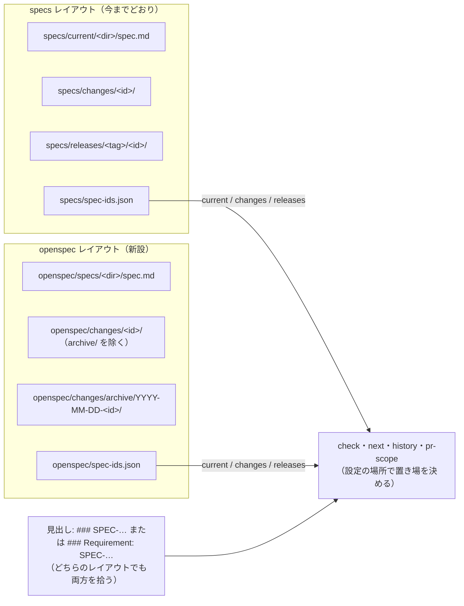

# 変更: OpenSpec の置き場（`openspec/`）と見出し（`### Requirement:`）を読めるようにする（openspec レイアウト）

- 対象: `config`（設定の探し方と置き場の対応）、`format`（見出しの拾い方）、`check`（読む場所と出力の 1 行目）、`init`（`--layout openspec`）、`history`（版の列）、`pr-scope`（変えてよいパス）。`next` と `frontmatter` は変えない（`next` は config の置き場に従うだけ）
- 実装の変更: 要（spec-ids 0.5.0）
- 実装の変更の補足: ID の形式・front matter のキー・テスト名の規則は変えない。specs レイアウトのリポジトリ（houki 系、spec-ids 自身）の `check` の結果は、出力の 1 行目が増えること以外は 0.4.0 と同じになる
- 状態: 草案
- 起こした日: 2026-10-14（JST）
- 起こした役: Spec Steward（`docs/operations.md` の 1.3）。PDF family の計画 `pdf-agent-stack/docs/specs/31-openspec-spec-ids-adoption-plan.md` の §2・§3.1 から起こした
- 対象 Issue: 未起票（この PR を開くときに Issue を立て、`Refs #N` を付ける）
- 前提: main の `1132520`（2026-10-14 JST の作業ツリー）から切った。`specs/changes/` と `specs/releases/` は空

## なぜ変えるか

PDF family の 4 MCP と 2 ライブラリに、仕様の置き場と手順として OpenSpec 1.14.1 を、仕様 ID とテストの突合として spec-ids を重ねて入れる計画がある。2026-10-14（JST）に隔離環境で確かめたところ、両者は次の 3 点で食い違う。

| 項目               | OpenSpec 1.14.1                                                                             | spec-ids 0.4.0                                                                            |
| ------------------ | ------------------------------------------------------------------------------------------- | ----------------------------------------------------------------------------------------- |
| 正本の置き場       | `openspec/specs/<cap>/spec.md`（`dist/core/openspec-root.js` の定数。設定で変えられない）   | `specs/current/<dir>/spec.md`（README「決めるものの分担」。設定で変えられない）           |
| 差分と取り込み済み | `openspec/changes/<name>/`、archive で `openspec/changes/archive/YYYY-MM-DD-<name>/` へ移す | `specs/changes/<id>/`、取り込みで `specs/releases/<tag>/<id>/` へ移す                     |
| 要求の見出し       | `### Requirement: <名前>`（それ以外の `###` は無視して INFO を出す）                        | `### SPEC-… 題`（`src/format.mjs` の `HEADING_RE`。`### Requirement: SPEC-…` は拾わない） |

OpenSpec 側は変えられないので、spec-ids 側で「置き場」と「見出しの先頭」の 2 点を受け付ける形にする。front matter（OpenSpec は読まずに通し、archive でもそのまま残る）、差分の `specs/<dir>/spec.md` の置き方（同形）、ID の形式、テスト名の規則はそのまま使える。

確かめた値（2026-10-14 JST、`@fission-ai/openspec@1.14.1` と `@shuji-bonji/spec-ids@0.4.0` を npm から隔離環境に入れて実行）:

- front matter 付き・日本語本文・`### Requirement: SPEC-PDFREADER-READ-TEXT-001 題` の正本と、`## ADDED Requirements` の差分で `openspec validate --all` は exit 0（警告は Purpose の文字数だけ）
- `openspec archive <name> -y` の後、正本に差分の Requirement が足され、front matter と `Requirement: SPEC-…` の見出しはそのまま残る。`proposal.md` の front matter も archive 先に残る。変更フォルダーに置いた `record.md`（OpenSpec が知らないファイル）も archive 先に移る
- spec-ids 0.4.0 の `check` は、`openspec/` の下を読まない（`current: 0 files`）。`specs/current/` に置き直しても `### Requirement: SPEC-…` の見出しは数えない（`current: 1 files, 0 IDs`）。`### SPEC-…` に直すと通る

## 今の動き（spec-ids 0.4.0）

- 設定は `specs/spec-ids.json` だけを上へ辿って探す（SPEC-SPECIDS-CONFIG-001）。置き場は `specs/current`・`specs/changes`・`specs/releases/<tag>/<id>` で固定（config の「できないこと」）
- 仕様書の ID は `###` と空白の直後に書いたものだけを数える（SPEC-SPECIDS-FORMAT-003）
- `check` の出力の 1 行目は `current: … / changes: …`（SPEC-SPECIDS-CHECK-001）
- `init` は `specs/` の 3 つの `.gitkeep`・`specs/spec-ids.json`・`spec-gate.yml` を作る（SPEC-SPECIDS-INIT-001）
- `history` の「版」は `specs/releases/<tag>/` の `<tag>`（SPEC-SPECIDS-HISTORY-001）
- `pr-scope` は `specs/changes/`・`specs/current/<dir>/spec.md`・`specs/releases/` のパスで PR の種類ごとの範囲を見る（SPEC-SPECIDS-PR-SCOPE-007〜023）

## 変えた後の動き

| 項目                     | 変えた後                                                                                                                                                                                                                                                       |
| ------------------------ | -------------------------------------------------------------------------------------------------------------------------------------------------------------------------------------------------------------------------------------------------------------- |
| 設定の探し方             | 各ディレクトリで `openspec/spec-ids.json` → `specs/spec-ids.json` の順に探し、最初に見つかったものを使う。見つかった場所でレイアウトが決まる（`openspec/` なら openspec、`specs/` なら specs）。任意のキー `layout` で明示してもよいが、場所と食い違えばエラー |
| 置き場（openspec）       | current = `openspec/specs/<dir>/spec.md`、changes = `openspec/changes/<id>/`（`archive` を除く）、releases = `openspec/changes/archive/<YYYY-MM-DD-id>/`。取り込み済みの差分の ID はフォルダー名から先頭の `YYYY-MM-DD-` を除いたもの、版はその `YYYY-MM-DD`   |
| 見出し                   | `###`、空白、任意の `Requirement:` と空白、ID の順。どちらのレイアウトでも両方の形を数える                                                                                                                                                                     |
| `check`                  | 出力の先頭に `layout: <specs または openspec>` の 1 行を足す。読む場所はレイアウトに従う。検査 1〜7 の意味は変えない                                                                                                                                           |
| `init --layout openspec` | `openspec/` が無ければ `openspec init` を案内して exit 2。`openspec/spec-ids.json`（`layout: "openspec"` 入り）と、`openspec validate --all` → `spec-ids check` の順に動く `spec-gate.yml` を作る。`.gitkeep` は作らない                                       |
| `history`                | openspec レイアウトでは「差分」の欄を `YYYY-MM-DD-` を除いた ID、「版」の欄を `YYYY-MM-DD` にする。`--json` の `version` も同じ文字列                                                                                                                          |
| `pr-scope`               | パスをレイアウトに合わせて写す。実装 PR で `openspec/changes/<id>/` → `openspec/changes/archive/YYYY-MM-DD-<id>/` の移動を通す。エラーの文のパスもレイアウトに従う                                                                                             |

## 変わる振る舞い

| 機能     | 変わること                                                                                                                    | ID                                |
| -------- | ----------------------------------------------------------------------------------------------------------------------------- | --------------------------------- |
| config   | 設定を 2 か所の順で探す。`layout` キー。openspec レイアウトの置き場と、archive のフォルダー名の読み方。設定が無いときの案内文 | ADDED 007〜010、MODIFIED 001・006 |
| format   | `### Requirement: SPEC-…` を数える                                                                                            | ADDED 006、MODIFIED 003           |
| check    | 読む場所がレイアウトに従う。出力の 1 行目。specs レイアウトの結果は 0.4.0 と同じ                                              | ADDED 021〜023、MODIFIED 001・020 |
| init     | `--layout openspec`。openspec 用の `spec-gate.yml` と AGENTS.md の節                                                          | ADDED 005〜007                    |
| history  | openspec レイアウトの「差分」と「版」の欄。文の中のパス                                                                       | ADDED 012・013                    |
| pr-scope | openspec レイアウトのパスの対応。archive への移動                                                                             | ADDED 024・025                    |

## 変わらない振る舞い

- 仕様 ID の形式（SPEC-SPECIDS-FORMAT-001・002）、テスト名からの拾い方（FORMAT-004・005）、front matter のキーと値（FRONTMATTER-001〜019）、`next` の採番（NEXT-001〜004）
- specs レイアウトでの `check`・`history`・`pr-scope` の結果。出力に 1 行足す（CHECK-001）こと以外は 0.4.0 と同じ。houki 系 3 リポジトリと spec-ids 自身で、publish 後に `npx @shuji-bonji/spec-ids@0.5.0 check` を 1 回走らせて確かめる
- ブランチ名の接頭辞（PR-SCOPE-001）
- `init` の既定（`--layout` を付けなければ specs レイアウト。INIT-001〜004 のとおり）

## 対象外

- OpenSpec の `openspec validate` が見るもの（節構成・Scenario・SHALL）を spec-ids で見ること。`spec-gate.yml` で OpenSpec の後に `check` を動かすだけ
- OpenSpec の `openspec/changes/<id>/specs/<dir>/spec.md` の `## ADDED/MODIFIED/REMOVED Requirements` の意味を読むこと（今までどおり `###` の見出しだけ）
- `openspec archive` を spec-ids から呼ぶこと、取り込みの自動化（`spec-ids apply`。`docs/operations.md` の 10 章）
- 2 つのレイアウト間の変換（`specs/` ⇄ `openspec/`）。PDF family の計画の Phase 4 で実測してから決める
- `@spec <ID> #<hash>` のマーカーと hash（計画の §3.3。0.6.0 の候補）
- `kind` に `lib` を足すこと（計画の §10-6。別の仕様 PR）

## 人が判断すること

| #   | 問い                                                                     | 案（先頭が Steward の推奨）                                                                                                                                                                                                                |
| --- | ------------------------------------------------------------------------ | ------------------------------------------------------------------------------------------------------------------------------------------------------------------------------------------------------------------------------------------ |
| 1   | `layout` キーを設定に持つか                                              | A: 持つ（任意。場所と食い違えばエラー）。設定だけを読んだときにレイアウトが分かる。B: 持たない（場所だけで決める）。キーが 1 つ減る                                                                                                        |
| 2   | `check` の出力に `layout:` の行を足すか                                  | A: 足す（1 行目）。CI のログでどちらを読んだか残る。B: 足さない。0.4.0 と出力が完全に同じになるが、openspec レイアウトでも `current:` と書かれた行だけになる                                                                               |
| 3   | openspec レイアウトの「版」の欄                                          | A: archive のフォルダー名の先頭 `YYYY-MM-DD`。B: proposal.md に任意キー `released: v0.17.0` を足し、あればそれを出す（front matter の形が増えるので frontmatter の仕様 PR になる）                                                         |
| 4   | `init --layout openspec` が作る `spec-gate.yml` で OpenSpec をどう呼ぶか | A: `npx openspec validate --all`（利用側が `@fission-ai/openspec` を devDependencies に入れる。spec-ids 自身の `npx spec-ids` と同じ形）。B: 版を環境変数で固定して `$RUNNER_TEMP` に入れる（PDF family の計画の §7 の形。雛形が長くなる） |
| 5   | `.gitkeep` を openspec レイアウトで扱うか                                | A: `openspec/specs/.gitkeep`・`openspec/changes/.gitkeep`・`openspec/changes/archive/.gitkeep` を `pr-scope` で止めない（`openspec init` がこれらを作るため）。`init --layout openspec` は作らない                                         |
| 6   | 取り込み済みの差分の ID の読み方                                         | A: archive のフォルダー名から先頭の `YYYY-MM-DD-` を除く。`YYYY-MM-DD-` で始まらないフォルダーはそのまま ID とする（OpenSpec を使わずに手で移したとき）                                                                                    |

## 実装 PR で直す文書

- README: 「決めるものの分担」の置き場の行を「2 つのレイアウトのどちらか」に、「仕様書の書き方」に `### Requirement: SPEC-…` の形を、「導入」に `--layout openspec` を足す。置き場の対応表（この文書の「変えた後の動き」の表）を載せる
- `docs/operations.md`: 9 章「他のリポジトリへの導入」に openspec レイアウトの手順を足す
- `templates/`: `spec-gate.yml` の openspec 版と、`agents-section.md` の openspec 版
- CHANGELOG: 0.5.0
- `.github/workflows/spec-gate.yml` の `SPEC_IDS_VERSION` は、publish の後の別 PR で 0.5.0 にする（AGENTS.md「版を上げる手順」）
