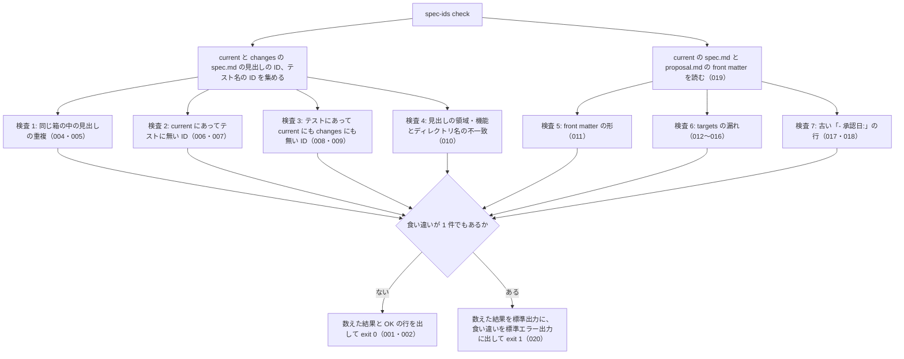

# 機能: check（仕様 ID とテストの突き合わせと、承認の記録の検査）

- 版: current
- 起こした元: v0.4.0 の `bin/spec-ids.mjs`（`check`）、`src/check.mjs`、`src/approval.mjs`、`src/proposals.mjs`、`src/scan.mjs`、`test/check.test.mjs`、`test/check-approval.test.mjs`、`test/cli.test.mjs`、README の「突合 `spec-ids check`」「終了コード」
- 関連する Issue: spec-ids #5（0.3.0 で検査 5〜7 を足した）、spec-ids #8

この文書は「`spec-ids check` は何を読み、何を止め、何を出すか」を書きます。仕様 ID の形と拾い方は format の仕様（SPEC-SPECIDS-FORMAT-001〜005）、front matter のキーの決まりは frontmatter の仕様（SPEC-SPECIDS-FRONTMATTER-001〜019）にあり、この文書はそれを使って何を検査するかを書きます。

## アクター

- 利用側の CI（`spec-gate` のジョブ）。PR と main への push で `spec-ids check` を実行し、終了コードが 0 でなければ止める
- 人とエージェント。手元で実行し、食い違いの一覧を見て仕様かテストを直す
- Node の API の利用者。`check(root, config)` の戻り値を読む

## 入力

| もの | 内容 |
| --- | --- |
| 設定 | `specs/spec-ids.json`（SPEC-SPECIDS-CONFIG-001〜006）。引数とオプションは無い |
| current | `specs/current/` の下の `spec.md`（出荷済みの正） |
| changes | `specs/changes/` の下の `spec.md`（承認済みでも未出荷の差分） |
| 差分 | `specs/changes/<id>/proposal.md` と `specs/releases/<tag>/<id>/proposal.md`、それぞれの `specs/<dir>/spec.md` |
| テストファイル | 設定 `tests` の glob に合うファイル（SPEC-SPECIDS-CONFIG-004・005） |

## 処理の流れ

読んでから終了コードを返すまでに、何をどの順で確かめるかを示します。図の中の番号は「できること」の仕様 ID の末尾 3 桁です。



## できること

### SPEC-SPECIDS-CHECK-001 食い違いが無ければ、数えた結果と OK の行を出して exit 0

検査 1〜7 のどれにも当たらなければ、次の 4 行を標準出力に出し、終了コード 0 で終わる。標準エラー出力には何も出さない。

```
current: <current の spec.md の数> files, <current の見出しの ID の数> IDs / changes: <changes の spec.md の数> files, <changes の見出しの ID の数> IDs
proposals: changes <specs/changes の proposal.md の数>, releases <specs/releases の proposal.md の数>
tests: <テストファイルの数> files, <テスト名の ID の数> IDs
OK: 仕様 ID とテストが一致しています
```

ID の数は、同じ ID を 1 つと数えた数。

例: current に 2 件の見出しの `spec.md` が 1 つ、取り込み済みの差分が 1 つ、その 2 件の ID を名前に書いたテストファイルが 1 つのリポジトリでは、`current: 1 files, 2 IDs / changes: 0 files, 0 IDs`・`proposals: changes 0, releases 1`・`tests: 1 files, 2 IDs`・`OK: 仕様 ID とテストが一致しています` を出して終了コード 0。

### SPEC-SPECIDS-CHECK-002 出力の 2 行目に、差分の proposal.md の数を出す

出力の 2 行目は `proposals: changes <数>, releases <数>` で、`specs/changes/<id>/proposal.md` と `specs/releases/<tag>/<id>/proposal.md` の数を出す。1 行目と 3 行目、`OK:` の行は 0.2.0 と同じ形。

例: 草案 1 つと取り込み済み 2 つのリポジトリでは `proposals: changes 1, releases 2`。

### SPEC-SPECIDS-CHECK-003 Node の API の check() は、検査ごとの一覧と数えた結果を返す

`check(root, config)` は、`ok`（食い違いが無いか）・`counts`・`duplicated`・`missingTests`・`missingSpecs`・`misplaced`・`frontMatter`・`missingTargets`・`legacyLines` を持つオブジェクトを返す。`counts` は `currentFiles`・`currentHeadings`・`changesFiles`・`changesHeadings`・`testFiles`・`testIds`・`changesProposals`・`releasesProposals` の 8 つの数。

例: 見出しの無い current の `spec.md` が 2 つ、草案と取り込み済みの差分が 1 つずつ、テストファイルが無いリポジトリでは、`counts` は `currentFiles: 2`・`changesProposals: 1`・`releasesProposals: 1` でほかは 0、`frontMatter`・`missingTargets`・`legacyLines` は空の配列、`ok` は `true`。

### SPEC-SPECIDS-CHECK-004 検査 1: 同じ箱の中で、同じ ID の見出しが 2 回以上あれば止める

current の中、または changes の中で、同じ ID の見出しが 2 回以上あれば止める（採番の衝突）。同じ `spec.md` の中の 2 回も、別の差分の `spec.md` どうしの 2 回も数える。止めた ID には、箱（`current` か `changes`）と、見出しのあったファイルを出現の数だけ付ける。

例: current の `spec.md` で `### SPEC-NTA-GET-TSUTATSU-001` を 2 回書くと、その ID を `current` の重複として、ファイルを 2 つ付けて止める。`specs/changes/20260925-a/spec.md` と `specs/changes/20260925-b/spec.md` の両方に `### SPEC-NTA-GET-TSUTATSU-003` があると、`changes` の重複として止める。

### SPEC-SPECIDS-CHECK-005 current と changes のあいだの同じ ID は重複にしない

current の見出しと changes の見出しに同じ ID があっても、重複として止めない。`MODIFIED`・`REMOVED` の差分は current と同じ ID の見出しを持つため。

例: current に `SPEC-NTA-GET-TSUTATSU-002` があり、`specs/changes/20260925-x/spec.md` の `## MODIFIED` に `### SPEC-NTA-GET-TSUTATSU-002` があっても、テストがそろっていれば通る。

### SPEC-SPECIDS-CHECK-006 検査 2: current の見出しにあってテストに無い ID は止める

current の見出しの ID が、どのテスト名にも無ければ止める。changes に同じ ID の見出しがあっても、current にある ID にはテストを求める。

例: current に `001` と `002` の見出しがあり、テスト名に `SPEC-NTA-GET-TSUTATSU-001` しか無ければ、`SPEC-NTA-GET-TSUTATSU-002` を止める。`002` を `MODIFIED` で書いた差分が changes にあっても同じ。

### SPEC-SPECIDS-CHECK-007 changes にだけある ID には、テストを求めない

changes の見出しにだけあり current に無い ID は、テスト名に無くても止めない。仕様 PR をマージしてから実装 PR までのあいだを通すため。

例: `specs/changes/20260925-x/spec.md` の `## ADDED` に `### SPEC-NTA-GET-TSUTATSU-003` があり、テストにまだ無くても通る（`counts.changesHeadings` は 1）。

### SPEC-SPECIDS-CHECK-008 検査 3: テストにあって、current にも changes にも見出しが無い ID は止める

テスト名の ID が、current の見出しにも changes の見出しにも無ければ止める（仕様を外したのにテストが残っている、または打ち間違い）。changes の見出しにあれば、current にまだ無くても通す（実装 PR の途中）。本文で触れているだけの ID は、見出しが無いものとして止める（SPEC-SPECIDS-FORMAT-003）。

例: テスト名に `SPEC-NTA-GET-TSUTATSU-009` があり、どの見出しにも無ければ止める。`SPEC-NTA-GET-TSUTATSU-003` が changes の `## ADDED` の見出しにあれば、テスト名に書いても通る。current の本文で `SPEC-NTA-GET-TSUTATSU-005` に触れているだけで、テスト名にその ID があれば止める。

### SPEC-SPECIDS-CHECK-009 specs/releases の spec.md の見出しは数えない

`specs/releases/` の下の `spec.md` の見出しの ID は、current としても changes としても数えない。取り込み済みの差分と、版の写しを置くため。

例: current とテストに `SPEC-NTA-GET-TSUTATSU-003` があり、`specs/releases/v1.0.0/20260925-x/specs/nta_get_tsutatsu/spec.md` に同じ見出し、`specs/releases/v0.9.0/nta_get_tsutatsu/spec.md` に `### SPEC-NTA-GET-TSUTATSU-099` があっても通る（`counts.changesFiles` は 0）。

### SPEC-SPECIDS-CHECK-010 検査 4: 見出しの ID の領域・機能が、設定とディレクトリ名から導いたものと違えば止める

`specs/current/<dir>/spec.md` の見出しの ID は、領域が設定の `domain`、機能が `<dir>` から導いた機能（SPEC-SPECIDS-FORMAT-002）でなければ止める。止めた ID には、ファイルと、期待する形 `SPEC-<領域>-<機能>-###` を付ける。

例: `specs/current/nta_get_tsutatsu/spec.md` の `### SPEC-NTA-SEARCH-TSUTATSU-002` は、期待する形 `SPEC-NTA-GET-TSUTATSU-###` を付けて止める。設定の `domain` が `NTA` のリポジトリで、見出しが `SPEC-EGOV-…` の 2 件は、2 件とも止める。

### SPEC-SPECIDS-CHECK-011 検査 5: front matter が無い、または決まりに合わないファイルを止める

`specs/current/<dir>/spec.md`、`specs/changes/<id>/proposal.md`、`specs/releases/<tag>/<id>/proposal.md` のそれぞれについて、front matter が無い（1 行目が `---` でない）もの、読めない行がある（SPEC-SPECIDS-FRONTMATTER-004〜008）もの、キーと値が決まり（SPEC-SPECIDS-FRONTMATTER-011〜019）に合わないものを、ファイルと理由の文を付けて止める。

例: front matter の無い `specs/current/nta_search_qa/spec.md`、front matter の無い草案と取り込み済みの `proposal.md` は止まる。`spec_id: "NTA"`（引用符）や `approved: 2026-09-22 # 初版`（コメント）のある `spec.md`、`targets:` を複数行で書いた `proposal.md` も止まる。

### SPEC-SPECIDS-CHECK-012 検査 6: 差分の specs/<dir>/spec.md があるのに targets に <dir> が無ければ止める

差分のフォルダー（`specs/changes/<id>/` と `specs/releases/<tag>/<id>/`）に `specs/<dir>/spec.md` があり、`proposal.md` の `targets` に `<dir>` が無ければ止める。

例: `targets: [nta_get_tsutatsu]` の草案に `specs/nta_get_tsutatsu/spec.md` と `specs/nta_search_qa/spec.md` があれば、`nta_search_qa` を止める。取り込み済みの差分でも同じ。

### SPEC-SPECIDS-CHECK-013 検査 6: 草案の targets の <dir> が、specs/current/ にも差分の specs/ にも無ければ止める

`specs/changes/<id>/proposal.md` の `targets` の `<dir>` が、`specs/current/<dir>/spec.md` にも、その差分の `specs/<dir>/spec.md` にも無ければ止める（打ち間違い）。

例: `targets: [nta_get_tsutasu, nta_new_tool]` で、差分に `specs/nta_new_tool/spec.md` がある草案は、`nta_get_tsutasu` だけを止める。

### SPEC-SPECIDS-CHECK-014 targets にあるのに差分の specs/<dir>/ が無いことは止めない

`targets` にある `<dir>` について、差分の `specs/<dir>/spec.md` が無くても止めない。実装の変更が要らない差分や、ID の無い節だけを直す差分で正しく起きるため。

例: `targets: [nta_get_tsutatsu, nta_search_qa]` で、差分の `specs/` に `nta_get_tsutatsu` だけがある取り込み済みの差分と、`specs/` の無い草案は通る。

### SPEC-SPECIDS-CHECK-015 取り込み済みの差分の targets が今の specs/current/ に無いことは止めない

`specs/releases/<tag>/<id>/proposal.md` の `targets` の `<dir>` が、今の `specs/current/` に無くても止めない。後の差分で機能を消すことがあるため。

例: `targets: [nta_removed_tool]` の取り込み済みの差分は通る。

### SPEC-SPECIDS-CHECK-016 proposal.md の本文の「- 対象:」と targets の食い違いは見ない

`proposal.md` の本文の「- 対象:」の行に書いた機能と、front matter の `targets` が違っても止めない。

例: 本文が「- 対象: `specs/current/nta_get_tsutatsu/spec.md`」で、`targets: [nta_search_qa]` の取り込み済みの差分は通る。

### SPEC-SPECIDS-CHECK-017 検査 7: 「- 承認日:」で始まる行があれば、ファイルと行番号を付けて止める

検査 5 と同じファイルに、行の先頭が `- 承認日:` の行があれば、ファイルと行番号（1 から）を付けて止める。0.2.0 までの、本文に承認日を書く形の残り。値が空の `- 承認日:` の行も止める。

例: current の `spec.md` の 9 行目、取り込み済みの `proposal.md` の 10 行目、草案の `proposal.md` の 10 行目（`- 承認日:` だけ）にあれば、3 件を止める。

### SPEC-SPECIDS-CHECK-018 行の途中の「- 承認日:」と、差分の specs/ の下の spec.md は見ない

行の途中にある `- 承認日:` と、差分のフォルダーの `specs/<dir>/spec.md` の中の `- 承認日:` の行は、検査 7 で止めない。

例: current の本文の「本文で「- 承認日:」の書き方に触れる。」の行と、`specs/changes/20261009-a/specs/nta_get_tsutatsu/spec.md` の `- 承認日: 2026-09-22（PR #49）` の行は止めない。

### SPEC-SPECIDS-CHECK-019 proposal.md の無いフォルダーは差分として数えない

`specs/changes/` と `specs/releases/<tag>/` の下のフォルダーのうち、`proposal.md` の無いものは差分として数えない（`proposals:` の数に入れず、検査 5〜7 の対象にしない）。

例: `specs/releases/v0.9.0/nta_get_tsutatsu/spec.md`（版の写し）と、`proposal.md` の無い `specs/releases/v1.0.0/20261001-x/specs/nta_search_qa/spec.md` だけのリポジトリは、`releases 0` で通る。

### SPEC-SPECIDS-CHECK-020 食い違いがあれば、種類ごとに見出しを付けて標準エラー出力に出し、exit 1

検査 1〜7 のどれか 1 件でもあれば、数えた結果の 3 行を標準出力に出し（`OK:` の行は出さない）、食い違いを種類ごとに、空行・見出しの行・`  ` で始まる行の順で標準エラー出力に出し、終了コード 1 で終わる。検査 5〜7 の見出しと行は次のとおり。

| 検査 | 見出しの行 | 続く行 |
| --- | --- | --- |
| 5 | `front matter が無い、または形が違う:` | `  <ファイル>: <理由>` |
| 6 | `targets の漏れ:` | `  <proposal.md>: <理由>`（理由に `<dir>` が入る） |
| 7 | `古い「- 承認日:」の行が残っている:` | `  <ファイル>:<行番号>` |

例: front matter の無い `specs/current/nta_search_qa/spec.md` の 2 行目に `- 承認日: 2026-09-22（PR #49）` があり、取り込み済みの差分の `specs/nta_search_qa/spec.md` が `targets` に無いリポジトリでは、標準出力は 3 行で、標準エラー出力に 3 つの見出しと、`  specs/current/nta_search_qa/spec.md: …`、`nta_search_qa` を含む `  specs/releases/v1.0.0/20261001-a/proposal.md: …`、`  specs/current/nta_search_qa/spec.md:2` が入る。CLI では終了コード 1。

## できないこと

- テストを実行すること（`npm test` の仕事）
- 番号の欠番を見ること
- 仕様の本文（`ADDED`・`MODIFIED`・`REMOVED` の意味、本文の参照）を読むこと
- `specs/current/` へ差分を取り込むこと、`specs/releases/` へ写すこと
- PR が変えてよい範囲を見ること（`pr-scope` の仕事。SPEC-SPECIDS-PR-SCOPE-001〜023）

## 未決

初版起こしで見つけた、意図か不具合かを人が決める項目と、テストが無いため ID を振らなかった項目です。決まったら「できること」に ID を振るか、`specs/changes/` の差分にします。

1. **`specs/current/<dir>/<下のフォルダー>/spec.md` の見出しは、current として数えるが、検査 4・5 の対象にならない。** `specs/current/a/b/spec.md` の `### SPEC-NTA-ZZZ-001` を current の ID として数え（`current: 2 files`）、テストを求める（検査 2）。一方で、機能をディレクトリ名から導けないので検査 4 で止めず、front matter も見ない（2026-10-11 JST に 0.4.0 の作業ツリーの `check` で確かめた）。採番（`next`）も同じ見出しを数える。意図か不具合か（止めるべきか）を決める
2. **検査 1〜4 の標準エラー出力の見出しの文のテストが無い。** 今は `同じ箱（current または changes）の見出しに同じ ID が 2 回以上ある（採番の衝突）:`・`見出しの ID が、その spec.md のディレクトリから導いた機能と一致しない:`・`specs/current にあってテストに無い ID:`・`テストにあって specs/current にも specs/changes にも見出しが無い ID:` を出す。テストを足してから SPEC-SPECIDS-CHECK-020 に含める
3. **食い違いの種類を並べる順。** 今は検査 1・4・2・3・5・6・7 の順（README の表の番号の順ではない）で、テストが無い
