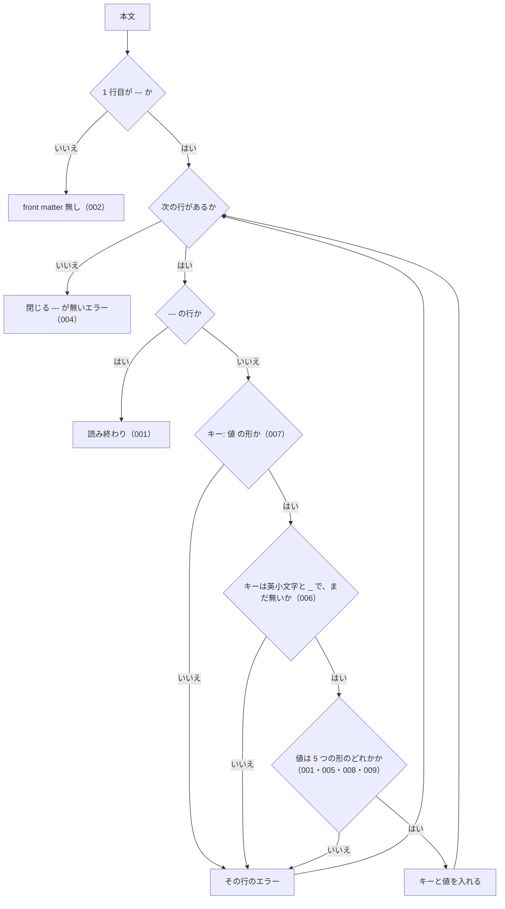

# 機能: frontmatter（front matter の読み方と、承認の記録のキー）

- 版: current
- 起こした元: v0.4.0 の `src/frontmatter.mjs`、`src/approval.mjs`（キーと値の決まり）、`src/index.mjs`、`test/frontmatter.test.mjs`、`test/check-approval.test.mjs`、README の「承認の記録の書き方（front matter）」
- 関連する Issue: spec-ids #5（0.3.0 で承認の記録を front matter にした）、spec-ids #8

この文書は、仕様書と差分の先頭に書く front matter について、「どの書式を読めるか」と「承認の記録としてどのキーに何を書くか」を書きます。決まりに合わないものを止めるのは `check` の検査 5（SPEC-SPECIDS-CHECK-011）で、PR の承認の空欄を止めるのは `pr-scope`（SPEC-SPECIDS-PR-SCOPE-010・SPEC-SPECIDS-PR-SCOPE-022）です。

## アクター

- 人。仕様 PR・初版起こし PR のマージの前に、`approved`（承認日）と `pr`（PR 番号）を書く
- Steward と Publisher。`spec_id`・`kind`・`implementation`・`targets`・`introduced_by` を書き、`approved:` と `pr:` は空のキーで置く
- `check`・`history`・`pr-scope`。front matter を読む。Node の API の利用者も `readFrontMatter` で読める

## 入力

front matter を書くファイルは次の 3 か所です。

| ファイル | 使えるキー |
| --- | --- |
| `specs/current/<dir>/spec.md` | `spec_id`・`kind`・`approved`・`pr`・`introduced_by` |
| `specs/changes/<id>/proposal.md`（草案） | `approved`・`pr`・`implementation`・`targets` |
| `specs/releases/<tag>/<id>/proposal.md`（取り込み済み） | `approved`・`pr`・`implementation`・`targets` |

## 処理の流れ

1 行ずつ読むときに、何をどの順で確かめるかを示します。図の中の番号は「できること」の仕様 ID の末尾 3 桁です。

## できること

### SPEC-SPECIDS-FRONTMATTER-001 1 行目の --- から次の --- までを読み、値を 5 つの形に分ける

ファイルの 1 行目が `---` のとき、次の `---` の行までを front matter として読む。1 行に `キー: 値` が 1 つ。値は前後の空白を除いてから、次の 5 つの形のどれかとして読む。

| 値の書き方 | 読んだ値 |
| --- | --- |
| 空 | 空（`null`） |
| 正の整数（`89`） | 数 |
| `YYYY-MM-DD`（`2026-10-01`） | 文字列 |
| 英数字と `_`・`-` だけの文字列（`required`・`20261004-db-location`） | 文字列 |
| 1 行の配列（`[a, b, c]`） | 文字列の配列 |

読んだ結果には、閉じる `---` の行までの行数を含める。

例: `---`・`approved: 2026-10-01`・`pr: 89`・`implementation: required`・`introduced_by: 20261004-db-location`・`targets: [common_errors, get_law_range, get_toc, search_fulltext]`・`empty:`・`---` の 8 行は、エラー無しで `approved` が `"2026-10-01"`、`pr` が `89`、`targets` が 4 つの文字列の配列、`empty` が空、行数 8 になる。

### SPEC-SPECIDS-FRONTMATTER-002 1 行目が --- でなければ、front matter は無いものとする

1 行目が `---` でない本文は、front matter が無いものとする（エラーの一覧も返さない）。先頭の空行の後の `---` も front matter として読まない。

例: `# 機能: get_toc` で始まる本文、`\n---\napproved: 2026-10-01\n---\n`（1 行目が空行）、空の本文は、どれも front matter 無し。

### SPEC-SPECIDS-FRONTMATTER-003 改行が CRLF でも同じに読む

改行が `\r\n` のファイルも、`\n` のファイルと同じに読む。

例: `---\r\napproved: 2026-10-01\r\npr: 89\r\n---\r\n# x\r\n` は、エラー無しで `approved` が `"2026-10-01"`、`pr` が `89`。

### SPEC-SPECIDS-FRONTMATTER-004 閉じる --- の行が無ければエラーにする

1 行目が `---` で、ファイルの終わりまでに次の `---` の行が無いときは、`front matter を閉じる --- の行がありません` をエラーにする。

例: `---\napproved: 2026-10-01\n# 変更: 本文\n` は、このエラーを含む。

### SPEC-SPECIDS-FRONTMATTER-005 コメント・引用符・複数行の値は受け付けない

値の後ろの `#` のコメント、`"`・`'` で囲んだ値、配列の要素の引用符、`- 要素` の行で続ける複数行の値は、読めない値としてその行をエラーにし、そのキーを入れない。複数行の配列は、`targets:` を空の値として読み、続く `  - …` の行をそれぞれ形のエラーにする。

例: `approved: 2026-10-01 # 承認日`・`implementation: "required"`・`implementation: 'required'`・`targets: [get_toc, "search_law"]` は、どれもエラー 1 件でキーが入らない。`targets:`・`  - get_toc`・`  - search_law` の 3 行は、エラー 2 件で `targets` は空。

### SPEC-SPECIDS-FRONTMATTER-006 キーは英小文字と _ だけで、同じキーは 1 回だけ

キーは英小文字と `_` だけで書く。大文字や `-` を含むキーの行はエラーにしてキーを入れない。同じキーが 2 回目に出た行はエラーにし、1 回目の値を残す。

例: `Approved: 2026-10-01`・`spec-id: EGOV`・`pr: 1`・`pr: 2` の 4 行は、エラー 3 件で、残るのは `pr: 1` だけ。

### SPEC-SPECIDS-FRONTMATTER-007 1 行に「キー: 値」が 1 つ。空の行や値だけの行はエラーにする

front matter の中の、`キー:` の形でない行（空の行、`:` の無い行）はエラーにする。

例: `approved: 2026-10-01`・空の行・`just-a-value` の 3 行は、エラー 2 件で `approved` だけが入る。

### SPEC-SPECIDS-FRONTMATTER-008 配列は 1 行で書き、要素は英数字と _・- だけ

配列は `[` と `]` で囲んだ 1 行に、`,` で区切って書く。要素の前後の空白は除く。`[]` は空の配列。要素に英数字と `_`・`-` 以外の文字（空白・`/`）があるとき、空の要素があるとき、`]` で閉じていないときはエラーにする。

例: `targets: [a_b, c-d, E9]` は `["a_b", "c-d", "E9"]`、`targets: []` は空の配列。`[a b]`・`[a,,b]`・`[a`・`[a/b]` は、どれもエラー 1 件。

### SPEC-SPECIDS-FRONTMATTER-009 0 や先頭が 0 の数は、正の整数として読まない

`0` と、先頭が `0` の数字の並び（`007`）は、数ではなく文字列として読む。

例: `pr: 0`・`x: 007` は、`pr` が文字列 `"0"`、`x` が文字列 `"007"`（`pr` の値としては、SPEC-SPECIDS-FRONTMATTER-014 で正の整数でないとして止まる）。

### SPEC-SPECIDS-FRONTMATTER-010 Node の API として readFrontMatter を公開する

パッケージの入口（`@shuji-bonji/spec-ids`）から `readFrontMatter` を import できる。返すものは、front matter が無ければ `null`、あれば `{ data, errors, lines }`（SPEC-SPECIDS-FRONTMATTER-001）。

例: `import { readFrontMatter } from '@shuji-bonji/spec-ids'` は、`src/frontmatter.mjs` の `readFrontMatter` と同じ関数。

### SPEC-SPECIDS-FRONTMATTER-011 決まったキー以外は書けない

`proposal.md` に書けるキーは `approved`・`pr`・`implementation`・`targets`、current の `spec.md` に書けるキーは `spec_id`・`kind`・`approved`・`pr`・`introduced_by` だけとする。ほかのキー（打ち間違い）があれば止める。止めるときの文は、知らないキーの名前と、使えるキーの一覧を示す。

例: `aproved: 2026-10-01` のある取り込み済みの `proposal.md` と、`targets: [x]` のある current の `spec.md` は、どちらも止まり、文に `aproved` が入る。

### SPEC-SPECIDS-FRONTMATTER-012 proposal.md の approved と pr は、草案では空でよく、取り込み済みでは必須

`specs/changes/<id>/proposal.md`（草案）では、`approved:` と `pr:` のキーを置き、値は空でよい。キーそのものが無ければ止める。`specs/releases/<tag>/<id>/proposal.md`（取り込み済み）では、`approved` と `pr` の両方に値が要る。

例: 草案の `approved:`・`pr:` が空なら通る。取り込み済みで `approved` が空、`pr` が空、`approved` のキーが無いもの、草案で `pr` のキーが無いものは、どれも止まる。

### SPEC-SPECIDS-FRONTMATTER-013 proposal.md の implementation は required か none、targets は 1 つ以上の配列

`proposal.md` には、草案でも取り込み済みでも、`implementation`（`required` か `none`）と `targets`（`specs/current/<dir>` の `<dir>` を 1 つ以上並べた配列）が要る。

例: 草案の `implementation: none` は通る。`implementation: yes`、`implementation` のキーが無い、`implementation:` が空、`targets: []`、`targets` のキーが無い、`targets: nta_get_tsutatsu`（配列でない）は、どれも止まる。

### SPEC-SPECIDS-FRONTMATTER-014 approved は実在する日付、pr は正の整数

`approved` に値があるときは、実在する日付の `YYYY-MM-DD` でなければ止める。`pr` に値があるときは、正の整数（`#` を付けない）でなければ止める。`proposal.md` と current の `spec.md` の両方に当てはまる。

例: `approved: 2026-13-01`・`approved: 2026-02-30`・`approved: 20261001`・`pr: 0`・`pr: abc` の `proposal.md` と、`pr: #49` の current の `spec.md` は、どれも止まる。

### SPEC-SPECIDS-FRONTMATTER-015 current の spec_id は必須で、設定の domain と同じ

current の `spec.md` には `spec_id` が要り、値は `specs/spec-ids.json` の `domain` と同じでなければ止める。

例: `domain` が `NTA` のリポジトリで、`spec_id: EGOV` の `spec.md` と、`spec_id` の無い `spec.md` は止まる。

### SPEC-SPECIDS-FRONTMATTER-016 current の kind は任意で、tool・cli・db・common のどれか

current の `spec.md` の `kind` は書かなくてよい。書くときは `tool`・`cli`・`db`・`common` のどれかでなければ止める。

例: `kind` の無いもの、`kind: tool`・`cli`・`db`・`common` は通る。`kind: api`・`kind: ツール` は止まる。

### SPEC-SPECIDS-FRONTMATTER-017 current は introduced_by が無ければ approved と pr が必須

current の `spec.md` に `introduced_by` が無い（または空の）ときは、初版の承認として `approved` と `pr` の両方に値が要る。

例: `approved` のキーが無い `spec.md`、`pr:` が空の `spec.md` は止まる。

### SPEC-SPECIDS-FRONTMATTER-018 introduced_by があれば approved と pr は要らない

current の `spec.md` に `introduced_by`（その機能を新しく作った差分の ID）があるときは、`approved` と `pr` が無くてよい。

例: `kind: cli`・`introduced_by: 20261004-db-location` だけの `cli_status` の `spec.md` は、`specs/releases/v0.25.0/20261004-db-location/proposal.md` の `targets` に `cli_status` があれば通る。

### SPEC-SPECIDS-FRONTMATTER-019 introduced_by の差分が無い、またはその差分の targets にこの機能が無ければ止める

`introduced_by` に書いた差分 ID の `proposal.md` が、`specs/changes/<id>/` にも `specs/releases/<tag>/<id>/` にも無ければ止める。あっても、その `targets` にこの `spec.md` の `<dir>` が無ければ止める。

例: `introduced_by: 20261001-nowhere`（どこにも無い差分）の `cli_sync` と、`introduced_by: 20261004-db-location`（`targets` が `[db_schema]` の差分）の `cli_status` は、どちらも止まる。

## できないこと

- YAML の書式の全体を読むこと（パーサーを使わない。上の 5 つの形だけ）
- `proposal.md` の本文（「- 対象:」の行など）と、front matter の `targets` を突き合わせること（SPEC-SPECIDS-CHECK-016）
- 承認日が承認した PR のマージ日と合っているかを確かめること

## 未決

初版起こしで見つけた、テストが無いため ID を振らなかった項目です。テストを足してから「できること」に ID を振ります。

1. **`introduced_by` のある `spec.md` に `approved` や `pr` を書いたとき。** 値が空でなければ、SPEC-SPECIDS-FRONTMATTER-014 と同じく形を確かめて止める。この組み合わせのテストが無い
