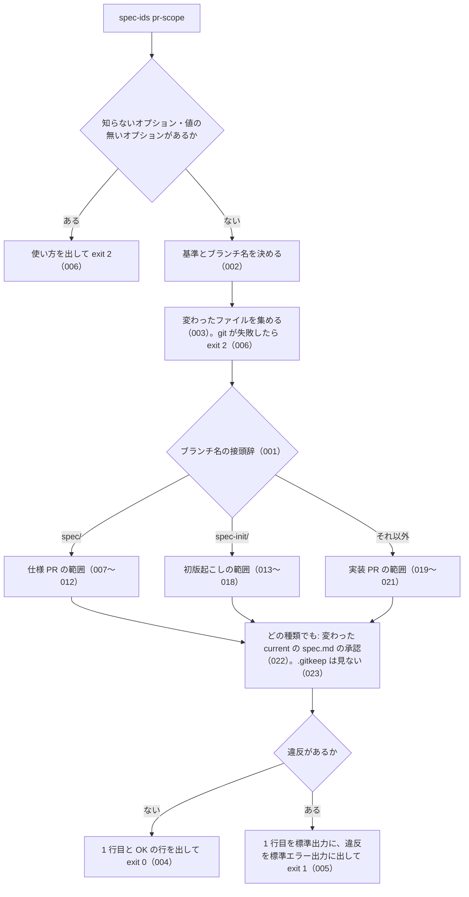

# 機能: pr-scope（PR の種類ごとに変えてよいパスと、承認の空欄の検査）

- 版: current
- 起こした元: v0.4.0 の `bin/spec-ids.mjs`（`pr-scope`）、`src/pr-scope.mjs`、`test/pr-scope.test.mjs`、README の「PR の種類ごとの検査 `spec-ids pr-scope`」「終了コード」、`docs/operations.md` の 1.2 と 4 章
- 関連する Issue: spec-ids #9（0.4.0 で houki 系 3 リポジトリの `check-pr-scope.mjs` をまとめた）、spec-ids #8

この文書は「`spec-ids pr-scope` は、PR の種類をどう決め、どの変更を通し、どの変更を止めるか」を書きます。front matter の読み方は frontmatter の仕様（SPEC-SPECIDS-FRONTMATTER-001〜010）にあります。front matter の書式そのもの（キーの打ち間違い・値の形・古い「- 承認日:」の行）は、この検査では見ず、`check`（SPEC-SPECIDS-CHECK-011・017）が見ます。

## アクター

- 利用側の CI（`spec-gate.yml` の `pr-scope` のジョブ）。PR のときだけ、基準のブランチとブランチ名を環境変数で渡して実行し、終了コードが 0 でなければ止める
- 人とエージェント。手元で、PR を出す前に範囲に収まっているかを確かめる

## 入力

| 入力 | 決め方 |
| --- | --- |
| 比べる基準のコミット | `--base`、無ければ環境変数 `BASE_REF`、無ければ `origin/main` |
| PR のブランチ名 | `--branch`、無ければ環境変数 `HEAD_REF`、無ければ今のブランチ |
| 変わったファイル | 基準との merge-base から `HEAD` までの、名前の変更を含む変更の一覧（追加・変更・削除・名前の変更） |
| テストファイルの行の差分 | 変わったテストファイルの、前後の文脈の無い行の差分 |
| ファイルの中身と `specs/releases/` | 作業ツリー |
| 設定 | `specs/spec-ids.json`（`tests` をテストファイルの判定に使う） |

## 処理の流れ

実行してから終了コードを返すまでに、何をどの順で確かめるかを示します。図の中の番号は「できること」の仕様 ID の末尾 3 桁です。



## できること

### SPEC-SPECIDS-PR-SCOPE-001 ブランチ名の接頭辞で PR の種類を決める

ブランチ名が `spec/` で始まれば仕様 PR（`spec`）、`spec-init/` で始まれば初版起こし（`spec-init`）、それ以外は実装 PR（`impl`）とする。接頭辞は固定で、設定では変えられない。

例: `spec/20260925-live-scope` は `spec`、`spec-init/lookup-by-law-id` は `spec-init`、`fix/54-live-scope` は `impl`。

### SPEC-SPECIDS-PR-SCOPE-002 ブランチ名と基準は、オプション・環境変数・既定値の順で決める

ブランチ名は `--branch`、無ければ環境変数 `HEAD_REF`、無ければ今のブランチの名前にする。基準のコミットは `--base`、無ければ環境変数 `BASE_REF`、無ければ `origin/main` にする。空の文字列の環境変数は、無いものとして扱う。

例: 今のブランチが `feat/x` で `HEAD_REF` が空なら `feat/x`（`impl`）。`HEAD_REF=spec/y` なら、今のブランチより優先して `spec/y`（`spec`）。`--branch fix/z --base main` は、`HEAD_REF=spec/y`・`BASE_REF=no-such-ref` より優先する。`BASE_REF` も `--base` も無いリポジトリでは `origin/main...HEAD` と比べる。

### SPEC-SPECIDS-PR-SCOPE-003 名前の変更は、元のパスと新しいパスの両方を変更として扱う

変わったファイルの一覧で、名前の変更（`R`）は元のパスと新しいパスを持つものとして読み、追加（`A`）・変更（`M`）・削除（`D`）はパスを 1 つ持つものとして読む。

例: `M\tsrc/a.ts` と `R100\tspecs/changes/x/spec.md\tspecs/releases/v1/x/spec.md` の 2 行は、`src/a.ts` の変更と、`specs/changes/x/spec.md` から `specs/releases/v1/x/spec.md` への名前の変更。

### SPEC-SPECIDS-PR-SCOPE-004 範囲に収まっていれば、1 行目と OK の行を出して exit 0

違反が無ければ、次の 2 行を標準出力に出し、終了コード 0 で終わる。標準エラー出力には何も出さない。

```
branch: <ブランチ名>（<種類>）、base: <基準>、変更 <変わったファイルの数> ファイル
OK: この種類の PR が変えてよい範囲に収まっています
```

例: `spec/20261010-x` で承認済みの `proposal.md` だけを足した PR を `BASE_REF=main` で検査すると、`branch: spec/20261010-x（spec）、base: main、変更 1 ファイル` と `OK: …` の 2 行で終了コード 0。

### SPEC-SPECIDS-PR-SCOPE-005 範囲の外の変更か承認の空欄があれば、違反を標準エラー出力に出して exit 1

違反があれば、1 行目（SPEC-SPECIDS-PR-SCOPE-004 と同じ形）だけを標準出力に出し、標準エラー出力に空行、`この種類の PR が変えてよい範囲の外の変更、または承認の空欄:`、違反ごとに `  <違反の文>` の行を出して、終了コード 1 で終わる。同じ文の違反は 1 つにまとめる。

例: `spec/20261010-x` で `proposal.md` と `src/get-law.ts` を変えた PR では、標準出力は `branch: spec/20261010-x（spec）、base: main、変更 2 ファイル` の 1 行で、標準エラー出力に `  仕様 PR（spec/*）は specs/changes/ だけを変えます: src/get-law.ts` が入り、終了コード 1。

### SPEC-SPECIDS-PR-SCOPE-006 オプションの誤り・設定が無い・git の失敗は exit 2

次のときは、検査をせずに終了コード 2 で終わる。

- 知らないオプション（`--json` など）、位置引数、値の無い `--base`・`--branch`（次がオプションのときを含む）。使い方を標準エラー出力に出す
- `specs/spec-ids.json` が見つからない（SPEC-SPECIDS-CONFIG-006）
- git が失敗した（基準のコミットが無い、git のリポジトリでない）。失敗した git のコマンドと、git のエラーの文を標準エラー出力に出す

例: `pr-scope --json`・`pr-scope --base`・`pr-scope --base --branch x`・`pr-scope extra` は終了コード 2。`origin/main` の無いリポジトリで基準を指定せずに実行すると、`origin/main...HEAD` を含む文を出して終了コード 2。

### SPEC-SPECIDS-PR-SCOPE-007 仕様 PR: specs/changes/ だけを変え、承認のある proposal.md があれば通る

仕様 PR は、`specs/changes/` の下だけを変え、`specs/changes/<id>/proposal.md` の front matter の `approved` と `pr` に値があれば通す。

例: `specs/changes/20260925-x/proposal.md`（`approved: 2026-09-25`・`pr: 60`）と `specs/changes/20260925-x/spec.md` を足した仕様 PR は通る。

### SPEC-SPECIDS-PR-SCOPE-008 仕様 PR: specs/changes/ の外の変更は止める

仕様 PR で `specs/changes/` の外（`src/` など）を変えると、`仕様 PR（spec/*）は specs/changes/ だけを変えます: <パス>` で止める。

例: 承認のある `proposal.md` と `src/lookup.ts` を変えた仕様 PR は、`src/lookup.ts` の違反 1 件で止まる。

### SPEC-SPECIDS-PR-SCOPE-009 仕様 PR: proposal.md が無ければ止める

仕様 PR の変更に、削除でない `specs/changes/<id>/proposal.md` が 1 つも無ければ、`仕様 PR（spec/*）に specs/changes/<id>/proposal.md がありません` で止める。

例: `specs/changes/20260925-x/spec.md` だけを足した仕様 PR は止まる。

### SPEC-SPECIDS-PR-SCOPE-010 仕様 PR: proposal.md の approved か pr が空なら止める

仕様 PR の `proposal.md` の front matter の `approved` か `pr` のどちらかが空、または無ければ、`承認日と PR 番号がありません（マージの前に front matter の approved と pr を書く）: <パス>` で止める。front matter の無い `proposal.md`（本文の「- 承認日:」の行だけの古い形）も止める。

例: `approved:` と `pr:` が空の草案、`approved` はあるが `pr:` が空のもの、本文に `- 承認日: 2026-09-25（PR #60）` があるだけで front matter の無いものは、どれも止まる。

### SPEC-SPECIDS-PR-SCOPE-011 仕様 PR: implementation: none の差分なら specs/current/<dir>/spec.md も変えてよい

仕様 PR の `proposal.md` のどれかの front matter が `implementation: none` なら、`specs/current/<dir>/spec.md` も変えてよい。変えた current の `spec.md` には承認が要る（SPEC-SPECIDS-PR-SCOPE-022）。

例: `implementation: none` の `proposal.md` と、承認のある `specs/current/resolve_abbreviation/spec.md` を変えた仕様 PR は通る。その `spec.md` の `approved` と `pr` が空なら、承認の違反 1 件で止まる。

### SPEC-SPECIDS-PR-SCOPE-012 仕様 PR: implementation: none でなければ specs/current/ を変えると止める

`implementation: none` の `proposal.md` が無い仕様 PR で `specs/current/<dir>/spec.md` を変えると、`（specs/current/ を書けるのは、proposal.md の front matter が implementation: none のときだけ）` を付けて止める。本文の「- 実装の変更: 不要」の行は `implementation: none` とみなさない。

例: `implementation: required` の差分で current の `spec.md` を変えた仕様 PR は止まる。front matter が `required` で、本文に `- 実装の変更: 不要` を足した差分も止まる。

### SPEC-SPECIDS-PR-SCOPE-013 初版起こし: spec.md の追加と、テスト名に ID を足すだけの変更は通る

初版起こしは、`specs/current/<dir>/spec.md` の追加・書き換えと、テストファイルの「テスト名に仕様 ID を足すだけ」の変更を通す。「足すだけ」は、テストファイルの消えた行と足された行を順に対にし、どの対も次の 3 つを満たす変更とする。

- 両方から ID（と直後の空白）を除くと同じ行になる
- 消えた行にあった ID が、足された行にすべて残っている
- 足された行の ID の方が多い

消えた行と足された行の数が違えば、足すだけとみなさない。

例: `it('未知の law_id は null', async () => {` を `it('SPEC-ABBR-LOOKUP-BY-LAW-ID-001 未知の law_id は null', async () => {` にし、承認のある `specs/current/lookup_by_law_id/spec.md` を足した初版起こしは通る。

### SPEC-SPECIDS-PR-SCOPE-014 初版起こし: ID の付いたテスト名に別の ID を足すのは通す

すでに ID の付いたテスト名に、別の ID を足す変更も「足すだけ」として通す。

例: `it('SPEC-EGOV-GET-LAW-001 範囲外の名前は OUT_OF_SCOPE', …` を `it('SPEC-EGOV-GET-LAW-001 SPEC-EGOV-COMMON-ERRORS-004 範囲外の名前は OUT_OF_SCOPE', …` にする変更は通る。

### SPEC-SPECIDS-PR-SCOPE-015 初版起こし: テスト名の ID を消す・別の ID に差し替える変更は止める

テスト名から ID を消す変更と、ID を別の ID に差し替える変更は「足すだけ」とみなさず、`初版起こし（spec-init/*）はテスト名に仕様 ID を足すだけです。それ以外の変更があります: <パス>` で止める。

例: `SPEC-EGOV-GET-LAW-001` を消す変更と、`SPEC-EGOV-GET-LAW-002` に差し替える変更は止まる。

### SPEC-SPECIDS-PR-SCOPE-016 初版起こし: テストの ID 以外を変える変更は止める

テストファイルの、ID を除いても同じにならない変更（期待値・テスト名の文・本文の変更）は止める（SPEC-SPECIDS-PR-SCOPE-015 と同じ文）。

例: `expect(lookupByLawId('999XX0000000000')).toBeNull();` を `….toBeUndefined();` にする変更は止まる。`it('x', …)` に ID を足すのと同時に、次の行の `it('y', …)` を `it('z', …)` にした変更も止まる。

### SPEC-SPECIDS-PR-SCOPE-017 初版起こし: spec.md とテスト以外を変えると止める

初版起こしで、`specs/current/<dir>/spec.md` とテストファイル以外のパス（`src/` など）を変えると、`初版起こし（spec-init/*）は specs/current/<dir>/spec.md とテスト名だけを変えます: <パス>` で止める。

例: 承認の空欄のある `specs/current/lookup_by_law_id/spec.md` を足し、`src/lookup.ts` を変えた初版起こしは、`src/lookup.ts` の違反と承認の違反（SPEC-SPECIDS-PR-SCOPE-022）の 2 件で止まる。

### SPEC-SPECIDS-PR-SCOPE-018 テストファイルは、設定 tests の glob に合うものと *.test.* の名前のもの

テストファイルとして扱うのは、設定 `tests` の glob（SPEC-SPECIDS-CONFIG-004）に合うファイルと、名前が `*.test.js`・`*.test.ts`・`*.test.mjs`・`*.test.cjs`・`*.test.mts`・`*.test.cts` のファイル。

例: `tests: ["src/**/*.spec.ts"]` のリポジトリでは、`src/app/a.spec.ts` と `tests/x.test.mjs` がテストファイルで、`src/app/a.ts` は違う。`src/app/a.spec.ts` のテスト名に ID を足す初版起こしは、この設定なら通り、設定が無ければ（テストファイルでないので）止まる。

### SPEC-SPECIDS-PR-SCOPE-019 実装 PR: specs/changes/ から specs/releases/ への移動は通し、それ以外の specs/changes/ の変更は止める

実装 PR は、`specs/changes/` から `specs/releases/` への名前の変更を通す。それ以外の `specs/changes/` の変更（書き換え・追加）は、`仕様 PR の外で specs/changes/ を変えています（許されるのは specs/releases/ への移動と、取り込み済みの差分の残りを消すことだけ）: <パス>` で止める。`proposal.md` を front matter の形に書き換える変更も止める（変換のための例外は入れない）。

例: `src/lookup.ts` と承認のある current の `spec.md` を変え、`specs/changes/x/spec.md` を `specs/releases/v0.21.0/x/spec.md` に移した実装 PR は通る。`specs/changes/x/spec.md` の書き換え、`specs/changes/20261009-inspect-pdf-meta-qa-jirei/proposal.md` の書き換えと追加は止まる。

### SPEC-SPECIDS-PR-SCOPE-020 実装 PR: 取り込み済みの差分の specs/changes/<id>/ に残ったファイルは消してよい

作業ツリーの `specs/releases/<tag>/` の下に同じ `<id>` のフォルダーがある差分について、実装 PR が `specs/changes/<id>/` の下のファイルを消すのは通す。`specs/releases/` に無い差分のファイルを消すのは止める。

例: `specs/releases/v1.0.0/20261001-a/` があるとき、`specs/changes/20261001-a/proposal.md` を消す実装 PR は通る。取り込み済みの差分が `20260927-y` だけなら、`specs/changes/20260927-x/proposal.md` を消すのは止まる。`specs/releases/v1.0.0/20261001-a/`・`specs/releases/v1.1.0/20261002-b/`・`specs/releases/.gitkeep` から集める取り込み済みの差分は `20261001-a` と `20261002-b`。

### SPEC-SPECIDS-PR-SCOPE-021 実装 PR: specs/ に触れない変更はそのまま通す

実装 PR で `specs/` の外だけを変えた変更は、検査せずに通す。

例: `README.md` だけを変えた実装 PR は通る。

### SPEC-SPECIDS-PR-SCOPE-022 どの種類でも、変わった current の spec.md に承認が無ければ止める

どの種類の PR でも、削除でない変更のあった `specs/current/<dir>/spec.md` の front matter に、`approved` と `pr` の両方の値か、`introduced_by` の値が無ければ、`承認日と PR 番号がありません（マージの前に front matter の approved と pr を書く。差分で作った機能なら introduced_by）: <パス>` で止める。front matter の無い `spec.md`（本文の「- 承認日:」の行だけの古い形）も止める。

例: `approved:` と `pr:` が空の current の `spec.md` を取り込んだ実装 PR、本文に `- 承認日: 2026-09-25（PR #60）` があるだけの `spec.md` を変えた実装 PR は止まる。`introduced_by: 20261004-db-location` だけの `specs/current/cli_new/spec.md` を足した実装 PR は通る。

### SPEC-SPECIDS-PR-SCOPE-023 specs/ の .gitkeep の追加と削除は、どの種類でも止めない

`specs/current/.gitkeep`・`specs/changes/.gitkeep`・`specs/releases/.gitkeep` の追加と削除は、どの種類の PR でも違反にしない。`.gitkeep` 以外の `specs/changes/` の追加は、今までどおり種類ごとの決まりで見る。

例: 実装 PR と初版起こしで 3 つの `.gitkeep` を足す変更、実装 PR で `specs/changes/.gitkeep` を消す変更は通る。実装 PR で `specs/changes/x/spec.md` を足すのは止まる。

## できないこと

- front matter の書式（キーの打ち間違い・値の形・古い「- 承認日:」の行）を見ること（`check` の検査 5・7）
- 承認日が正しいか、承認した人が誰かを確かめること（値があるかだけを見る）
- ブランチ名の接頭辞を設定で変えること
- テストの中身が仕様に合っているかを見ること

## 未決

初版起こしで見つけた、意図か不具合かを人が決める項目と、テストが無いため ID を振らなかった項目です。決まったら「できること」に ID を振るか、`specs/changes/` の差分にします。

1. **初版起こしで、新しいテストファイルを足すと止める。** 足すだけとみなすのは変更（`M`）のテストファイルだけで、追加（`A`）は SPEC-SPECIDS-PR-SCOPE-017 の文で止める。`docs/operations.md` の「既存テストの名前への仕様 ID の追加」と合っているが、テストが無い
2. **初版起こしで、`specs/current/<dir>/spec.md` を消す・名前を変えると止める。** 今の振る舞いだが、テストが無い
3. **設定のあるフォルダーがリポジトリのルートでないとき。** 変わったファイルの一覧を、設定のあるフォルダーからの相対パスで取る（そのフォルダーの外の変更は一覧に入らない）。テストが無い
